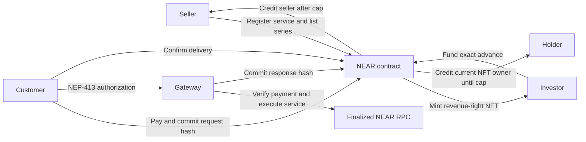

<p align="center">
  
</p>

# FIRST100

**Verifiable, transferable revenue rights for paid AI services on NEAR.**

[](https://github.com/karagozemin/FIRST100/actions/workflows/ci.yml)
[](LICENSE)
[](https://near.org/)

## What is FIRST100?

Imagine you have built an AI API that charges 1 NEAR per request.

You need funding to grow, but you do not want to sell equity or take out a loan. With FIRST100, you can offer the revenue from your next 100 API calls to an investor for 70 NEAR upfront.

Here is what happens:

- You receive 70 NEAR immediately.
- The investor receives an NFT representing the revenue rights to those 100 sales.
- Every time a customer pays for and confirms an API call, the revenue goes to the current NFT holder.
- After the 100th eligible sale, revenue goes back to you.
- The investor can transfer or sell the NFT before all 100 sales are completed.

If all 100 sales happen, the investor collects 100 NEAR on a 70 NEAR investment. If they do not, the investor may lose money.

**No equity. No company ownership. Just a defined share of future sales, enforced by a NEAR smart contract.**

*Example numbers are illustrative, not a live investment offering.*

FIRST100 lets an AI service finance a bounded set of future sales without selling the company, API ownership, or all future revenue. A seller lists the first `N` eligible sales, an investor funds the series and receives a NEP-171 revenue-right NFT, and each buyer-confirmed sale is routed by the contract to the NFT owner at settlement time.

The repository contains the product defined by PRD v3.0: the NEAR contract, hosted authenticated service gateway, SDK, live role-based application, sandbox integration tests, evidence verifier, and deployment tooling.

> **Current status:** the interactive application, public testnet contract, hosted gateway, automated test suite, and finalized explorer evidence are live. An independent security audit and legal review remain required before mainnet or real-value use.

## Why FIRST100

Traditional funding models sell broad ownership or create fixed debt. FIRST100 isolates a narrower asset: a contract-managed right to a finite number of future, paid, buyer-confirmed service calls.

| Participant | What they provide | What they receive |
| --- | --- | --- |
| Seller | A service, price, cap, expiration, and funding terms | Upfront financing and revenue after the cap |
| Investor | The exact configured advance | A transferable NFT that routes the remaining first-`N` settlements |
| Customer | Exact payment and explicit output confirmation | A payment-gated service result with request and response commitments |
| Auditor | No trust assumption about the UI or gateway cache | Contract views, events, transaction hashes, and replayable accounting |

The NFT does not represent equity, a guaranteed yield, control of the service, prior accruals, or revenue collected outside this protocol.

## Protocol at a glance



The gateway proves payment and response integrity; the customer remains responsible for deciding whether the output is acceptable. The contract is the accounting authority.

## How it works

1. **Register:** the seller registers a service operator, gateway account, and endpoint commitment.
2. **List:** the seller defines a unique series, advance, unit price, sale cap, expiration, and confirmation timeout.
3. **Fund:** one investor attaches the exact advance. The contract credits the seller and mints `right:<series_id>` to the investor.
4. **Pay:** a customer attaches the exact unit price and commits a canonical request hash onchain.
5. **Execute:** the gateway verifies the finalized payment transaction, NEP-413 proof, active account key, and request commitment before running the service.
6. **Commit:** the gateway submits the response hash to the contract.
7. **Confirm:** the customer confirms the same response hash. The contract reads the NFT owner in that block and credits the beneficiary.
8. **Transfer:** moving the NFT changes only future settlement routing. Previously accrued credit remains with the original account.
9. **Withdraw:** beneficiaries use pull payments. A failed NEAR transfer restores credit exactly once through the callback.

## Core guarantees

- A series can be funded only once and only with the exact advance.
- One service can have at most one active funded series.
- Buyer, series, and client nonce tuples cannot be replayed.
- An order reaches at most one terminal accounting outcome: settlement or refund.
- `settled_count` never exceeds `cap_n`.
- Revenue after the cap returns to the seller.
- Existing credits never move with the NFT.
- Settlement is blocked while an asynchronous `nft_transfer_call` resolver is pending.
- Credits, active escrow, and in-flight withdrawals reconcile through `audit_totals`.
- Failed withdrawals restore credit once; completed withdrawals do not recreate credit.

The complete rationale, lifecycle, accounting model, trust boundaries, and failure behavior are documented in:

## [Read the architecture document →](docs/ARCHITECTURE.md)

Supporting documents:

- [Product requirements and delivery record](docs/PRD.md)
- [Protocol invariants](docs/INVARIANTS.md)
- [Threat model](docs/THREAT_MODEL.md)
- [Known limitations](docs/KNOWN_LIMITATIONS.md)
- [90-second demo script](docs/DEMO_SCRIPT.md)

## Repository structure

| Path | Responsibility |
| --- | --- |
| `contracts/revenue-rights` | Rust contract, accounting state machine, events, and NEP-171 implementation |
| `gateway` | Payment and wallet verification, service execution, response commitment, local persistence, and serverless challenge support |
| `sdk` | RPC helpers, canonical hashing, amount conversion, investor policy evaluation, and independent ledger replay |
| `app` | Public landing plus live seller, investor, customer, holder, and auditor workflows |
| `tests/workspaces` | Optimized WASM tests against NEAR sandbox with six accounts |
| `tests/e2e` | Browser-level coverage for the public landing and live application route |
| `artifacts` | Optimized contract WASM and its SHA-256 checksum |
| `evidence` | Finalized testnet transaction manifest, service receipts, and refund proof |
| `scripts` | Reproducible contract build, sandbox test, and testnet deployment commands |
| `docs` | PRD, architecture, invariants, threat model, limitations, and demo guidance |

## Quick start

### Requirements

- Node.js 22 or newer
- npm
- Rust 1.95
- `wasm32-unknown-unknown` Rust target
- `curl` and `tar` for pinned tool downloads

The build script downloads the official cargo-near `0.23.0` binary into `.cache`, selects the correct platform artifact, and verifies its version before use. The workspace test script does the same for NEAR sandbox `2.14.0`.

```bash
npm install
rustup target add wasm32-unknown-unknown --toolchain 1.95.0
cp .env.example .env
```

### Run the application

Configure `.env` with a real contract ID, gateway account, and gateway private key. Never commit secrets.

```bash
npm run dev:gateway
npm run dev:app
```

Default local endpoints:

- Web application: Vite development URL printed by `dev:app`
- Gateway: `http://localhost:8787`
- Gateway health: `GET /health`

## Build and test

```bash
npm test                    # 35 contract + 15 gateway + 10 SDK tests
npm run build               # gateway, web application, and SDK production builds
npm run build:contract      # optimized WASM and checksum
npm run test:workspaces     # 5 end-to-end protocol tests on NEAR sandbox
npm run test:e2e            # Chromium UI smoke test
```

The sandbox suite deploys the optimized WASM and uses six isolated accounts to verify:

- one-time funding and NFT minting;
- first settlement to investor A;
- NFT transfer from A to B;
- preservation of A's prior credit;
- next settlement to B;
- post-cap revenue routing to the seller; and
- reconciliation of aggregate liabilities.

The committed WASM checksum is stored in [`artifacts/first100_revenue_rights.wasm.sha256`](artifacts/first100_revenue_rights.wasm.sha256).

## Contract interface

### State-changing methods

| Method | Caller | Deposit | Purpose |
| --- | --- | ---: | --- |
| `register_service` | Service operator | exactly `0.01 NEAR` | Register a service and authorized gateway |
| `set_service_active` | Service operator | none | Pause or resume new orders |
| `create_series` | Service operator | exactly `0.02 NEAR` | Define funding and revenue-right terms |
| `cancel_unfunded_series` | Seller | none | Cancel a listed series before funding |
| `fund_series` | Investor | exact advance | Credit the seller and mint the NFT |
| `create_order` | Customer | exact unit price | Escrow payment and commit the request hash |
| `acquire_execution_lease` | Gateway or operator | none | Acquire one time-bounded worker lease for an order |
| `release_execution_lease` | Lease holder | none | Release a failed execution attempt for immediate retry |
| `submit_delivery_hash_leased` | Lease holder | none | Commit the response hash and consume the matching lease |
| `confirm_delivery` | Order buyer | none | Settle escrow to the current beneficiary |
| `claim_refund` | Order buyer | none | Recover unresolved escrow after the deadline |
| `close_expired_series` | Any account | none | Close an expired series with no open orders |
| `withdraw` | Credited account | `1 yoctoNEAR` | Start an asynchronous pull-payment transfer |
| `nft_transfer*` | NFT owner or approved account | `1 yoctoNEAR` | Transfer future settlement rights |
| `nft_approve` / `nft_revoke*` | NFT owner | storage / `1 yoctoNEAR` | Manage marketplace-compatible transfer approvals |

### Important views

`get_service`, `get_services`, `get_series`, `get_series_page`, `get_order`, `get_execution_lease`, `get_credit`, `get_withdrawal`, `get_active_series`, `get_open_order_count`, `is_transfer_pending`, `audit_totals`, `nft_token`, `nft_tokens`, `nft_tokens_for_owner`, and `nft_metadata`.

Financial values are decimal yoctoNEAR strings in JSON. Nanosecond timestamps are also strings to avoid JavaScript integer precision loss.

## Gateway API

| Route | Purpose |
| --- | --- |
| `GET /health` | Runtime, network, contract, and trust-boundary status |
| `GET /services` | Typed adapter descriptors, request schemas, and metering model |
| `GET /services/:serviceId/quote` | Finalized active-series terms from the contract |
| `POST /orders/:orderId/challenge` | Short-lived wallet authorization challenge bound to buyer and order |
| `POST /orders/:orderId/execute` | Authenticated payment verification and service execution |
| `GET /orders/:orderId/status` | Onchain order state plus local execution record |

The gateway selects a typed adapter from the order's finalized onchain `service_id`. The default registry includes deterministic NEAR account research and account risk signals, exposes request schemas, and fails closed for unconfigured service identifiers.

## Investor policy engine

The SDK evaluates each finalized listing against explicit limits for maximum advance, minimum remaining calls, maximum break-even calls, and allowed service identifiers. The application exposes the spending and entitlement controls beside the onchain terms and blocks its funding action when a listing fails them.

This engine is deterministic decision support, not an unattended trading agent. It cannot hold a key or sign a transaction: the connected wallet must still present and approve the exact `fund_series` call.

## Evidence and verification

The public contract is deployed at [`first100-v2-20261115.testnet`](https://explorer.testnet.near.org/accounts/first100-v2-20261115.testnet). Its evidence manifest records 23 finalized transactions spanning deployment, portfolio and execution-lease upgrades, funding, two paid service executions, transfer-aware settlement, timeout refund, and completed withdrawals.

The evidence verifier is designed to fail closed. It rejects an undeployed manifest, a missing contract ID, placeholder hashes, failed transactions, wrong receivers, missing terminal events, cap violations, duplicate terminal outcomes, and totals that do not reconcile with `audit_totals`.

Verify the live evidence:

```bash
npm run verify:ledger -- evidence/testnet-transactions.json
```

The two service receipts are preserved in [`evidence/service-receipts.json`](evidence/service-receipts.json). Each includes the finalized RPC output and the hashes that connect payment, delivery, and buyer confirmation.

## Testnet deployment

The deployment command uses the local NEAR keychain and never accepts a raw private key as a script argument.

```bash
export CONTRACT_ID=first100-yourname.testnet
export OWNER_ID=yourname.testnet
npm run deploy:testnet
```

The checked-in deployment is evidence, not a production endorsement. Use a separate account for any redeployment and never replace missing evidence with examples that look real.

## Security and limitations

This is testnet software, not audited production financial infrastructure. In particular:

- FIRST100 cannot prevent a seller from routing equivalent economic activity outside the protocol.
- Customer confirmation is a declared trust boundary; the current release has no quality oracle or arbitration.
- Local gateway mode uses an atomic JSON store. Hosted challenges are signed and stateless, while time-bounded onchain leases serialize multi-region execution and permit retry after worker failure.
- There is no distributed transaction that preserves a service output across a crash immediately before its delivery commitment. The included adapters are deterministic and replayable; side-effecting adapters need their own durable receipt store.
- Legal classification, taxation, and securities compliance are outside the implementation.

Read the full [threat model](docs/THREAT_MODEL.md) and [known limitations](docs/KNOWN_LIMITATIONS.md) before deployment.

## License

MIT. See [LICENSE](LICENSE).
