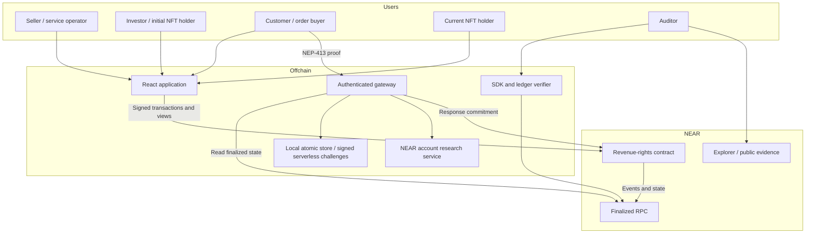
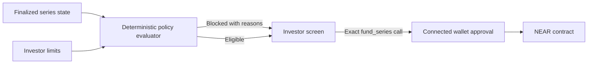
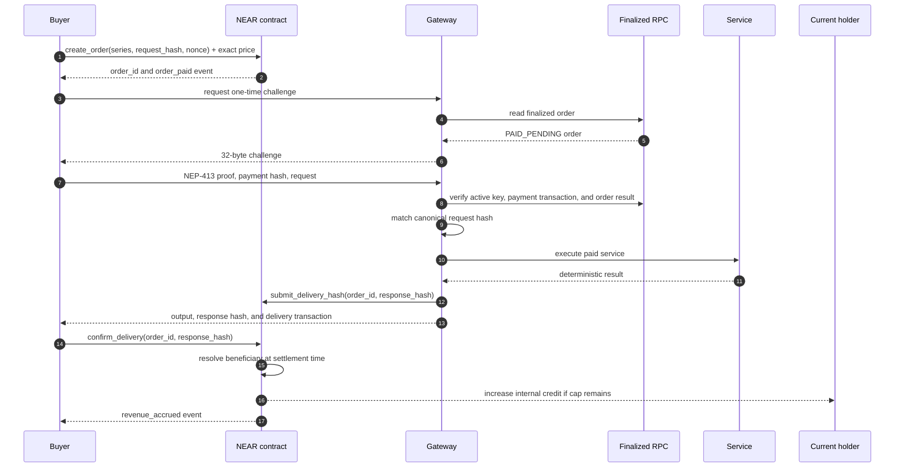
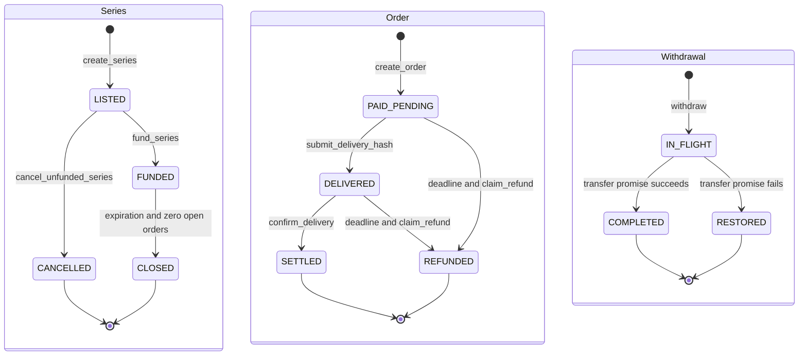
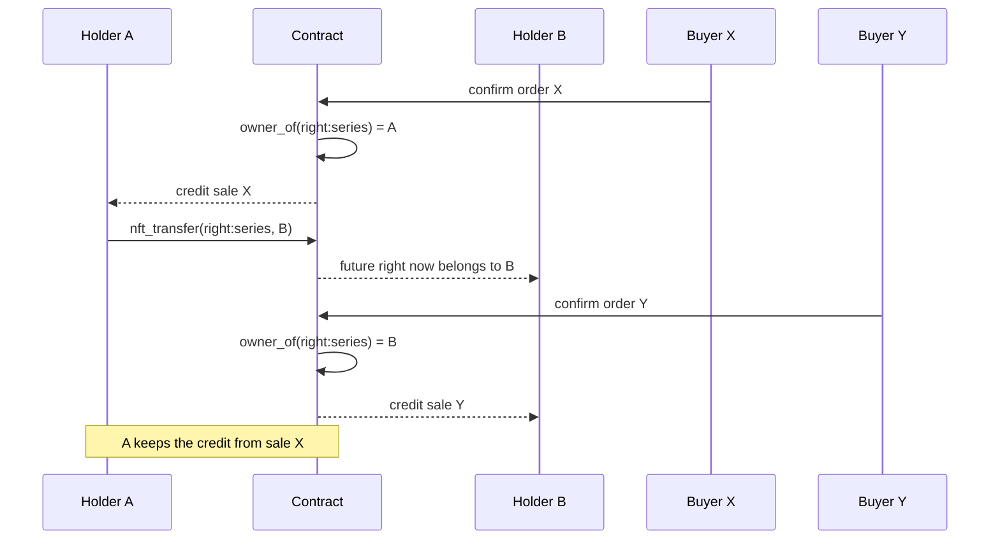

# FIRST100 architecture

This document describes the implemented architecture, its accounting model, trust boundaries, and failure behavior. It deliberately separates properties enforced by the contract from assumptions that remain outside the protocol.

## Design goals

FIRST100 is built around five constraints:

1. **Bounded entitlement:** the NFT routes only the first `N` confirmed sales in a funded series.
2. **Settlement-time ownership:** future revenue follows the NFT; historical credit does not.
3. **Verified payment path:** the gateway executes only after finalized onchain payment and wallet authorization.
4. **Explicit confirmation:** a response commitment proves integrity, while the buyer decides whether the output is acceptable.
5. **Auditable liabilities:** escrow, credits, and in-flight withdrawals remain independently reconcilable.

## System context



The contract owns protocol state and accounting. The gateway owns service execution and transaction verification. The application coordinates user workflows but is never an accounting authority.

The gateway resolves the order's series from finalized state and selects an adapter by its onchain `service_id`. Each adapter publishes a versioned request schema and metering model. Unknown identifiers fail closed; clients cannot select a different adapter than the funded series.

## Component responsibilities

| Component | Responsibilities | Explicitly not responsible for |
| --- | --- | --- |
| Revenue-rights contract | Series lifecycle, escrow, beneficiary selection, credits, refunds, withdrawals, NEP-171 ownership, events, audit totals | Service output quality, off-protocol revenue, legal classification |
| Gateway | Wallet proof, finalized payment verification, request commitment matching, typed adapter selection, service execution, response commitment, execution records | Final accounting, buyer acceptance, NFT ownership decisions |
| Service | Deterministic finalized NEAR account research | Payment verification or settlement |
| React application | Wallet coordination and role-specific workflows | Authoritative state, hidden accounting, evidence substitution |
| SDK and verifier | Canonical hashing, RPC access, policy evaluation, event replay, cap checks, evidence reconciliation | Modifying protocol state or signing transactions |
| Evidence manifest | References to real finalized testnet transactions | Placeholder or simulated proof |

## Onchain domain model

### Service

A service binds an operator account, an authorized gateway account, an endpoint commitment, and an active flag. The operator can pause new orders without rewriting existing order state.

### Revenue series

A series defines:

- the service and seller;
- the beneficiary NFT identifier;
- the `cap_n` entitlement limit;
- the current `settled_count`;
- exact unit price and funding advance;
- expiration and confirmation timeout; and
- lifecycle status.

Multiple unfunded listings may exist, but only one funded series can be active for a service at a time.

Services and series are also written to append-only discovery indexes. Paginated views apply optional status, seller, and service filters without making the web application an indexing authority.

### Investor policy boundary

The investor screen evaluates finalized series data locally through the SDK. A policy can constrain the advance, remaining entitlement, break-even call count, and allowed service identifiers.



Policy eligibility never grants signing authority. The evaluator has no key access, cannot submit a transaction, and does not predict demand or returns. A connected wallet must approve the exact funding call after the terms pass the selected limits.

### API order

An order stores the buyer, series, request hash, optional response hash, exact escrowed amount, timestamps, status, and final beneficiary. The buyer, series, and client nonce tuple is hashed into a unique order ID and cannot be reused.

### Credit and withdrawal

Settlement and refunds create internal account credits. Users withdraw through an asynchronous pull-payment flow. The amount moves from credit to `in_flight` before the transfer promise is issued, preventing a second withdrawal against the same liability.

## End-to-end paid call



If the order remains unresolved past its confirmation deadline, the buyer can call `claim_refund`. A refund and settlement cannot both become terminal outcomes for the same order.

## State machines



Terminal states are guarded against repeat processing. All financial arithmetic uses checked operations.

## Settlement-time NFT ownership

The beneficiary is intentionally not captured when payment enters escrow. It is selected when the buyer confirms delivery.



For `nft_transfer_call`, ownership resolution is asynchronous. The contract marks the token as pending, blocks settlement for that token, lets the resolver accept or revert the transfer, and only then removes the lock. This prevents a confirmation from observing ambiguous ownership.

The NFT exposes NEP-171 approval management and enumeration. Approval IDs authorize marketplace-style transfers, while `nft_tokens_for_owner` provides holder portfolio discovery. Existing testnet tokens were backfilled through an owner-only, idempotent extension initializer after the code upgrade.

After `settled_count == cap_n`, later confirmed orders route to the seller and no longer increment the entitlement count.

## Accounting model

The contract tracks three live liability classes:

```text
total_liabilities
  = total_credits
  + active_order_escrow
  + in_flight_withdrawals
```

| Value | Increases when | Decreases when |
| --- | --- | --- |
| `total_credits` | Funding credits the seller; settlement credits a beneficiary; refund credits a buyer; failed withdrawal restores credit | A withdrawal starts |
| `active_order_escrow` | A customer creates an order with the exact unit price | The order settles or is refunded |
| `in_flight_withdrawals` | A withdrawal starts | Its callback completes or restores the amount |
| `total_funded_advances` | A series is funded | Never; cumulative audit counter |
| `total_settled_revenue` | An order settles | Never; cumulative audit counter |
| `total_refunds` | An order is refunded | Never; cumulative audit counter |

`audit_totals` also reports contract balance, estimated storage lock, configured operating reserve, and a solvency flag. Storage deposits are not user credits and are not counted as protocol liabilities.

### Withdrawal rollback

1. Validate the caller and `1 yoctoNEAR` authorization deposit.
2. Subtract the requested amount from account credit.
3. Move the amount into the aggregate in-flight total.
4. Persist an `IN_FLIGHT` withdrawal record.
5. Issue the NEAR transfer promise.
6. On success, mark the record `COMPLETED` and remove the in-flight liability.
7. On failure, mark it `RESTORED`, remove the in-flight liability, and recreate the credit exactly once.

The callback is private and rejects a withdrawal that has already reached a terminal status.

## Commitments and evidence

### Request commitment

The client canonicalizes the service request and stores its SHA-256 hash in `create_order`. Before execution, the gateway canonicalizes the received request again and requires an exact match with the finalized onchain value.

### Response commitment

The gateway canonicalizes the service output, submits its SHA-256 hash through `submit_delivery_hash`, and returns both output and hash to the customer. `confirm_delivery` requires the customer to provide the exact committed hash.

A hash proves that the confirmed bytes match the committed bytes. It does not prove that the service answer is useful or correct.

### Independent evidence verification

The verifier reads finalized transactions from the evidence manifest, extracts FIRST100 terminal events from receipt logs, loads series caps from the contract, replays settlement and refund events, rejects duplicate terminal outcomes, and compares reconstructed totals with `audit_totals`.

The verification fails if the manifest is undeployed, contains placeholders, points at another receiver, includes a failed transaction, omits terminal events, violates a cap, or does not reconcile.

## Trust boundaries

| Boundary | Enforced property | Remaining assumption |
| --- | --- | --- |
| Customer to contract | Exact payment, unique nonce, escrow, terminal order state | Customer controls the signing account |
| Customer to gateway | NEP-413 proof, active full-access key, short-lived challenge | Wallet implementation signs the presented payload correctly |
| Gateway to RPC | Finalized state and transaction verification | At least one configured RPC endpoint is available and honest about finalized consensus |
| Gateway to service | Request hash match and deterministic result format | Gateway host and private key remain secure |
| Gateway to contract | Only the configured gateway or operator can commit delivery | Customer still decides whether to confirm |
| NFT holder to contract | NEP-171 ownership controls future settlement routing | Off-protocol ownership agreements are not enforced |
| Auditor to evidence | Public hashes, events, cap checks, and total reconciliation | Evidence manifest must include the complete claimed flow |

## Failure behavior

| Failure | Protocol response |
| --- | --- |
| Wrong funding amount | Transaction reverts; no NFT is minted |
| Second funding attempt | Transaction reverts because the series is no longer `LISTED` |
| Duplicate buyer nonce | Transaction reverts before a second order is created |
| Unauthorized delivery commitment | Transaction reverts |
| Request body differs from onchain hash | Gateway rejects execution |
| Payment transaction has wrong signer, receiver, method, or return value | Gateway rejects execution |
| Buyer does not confirm before the deadline | Buyer can claim a refund into internal credit |
| Response hash differs during confirmation | Transaction reverts |
| NFT resolver is pending | Settlement reverts until ownership becomes final |
| NEAR withdrawal transfer fails | Callback restores internal credit once |
| Gateway cache is unavailable | Onchain accounting remains intact; service execution availability is affected |
| RPC endpoint fails | Read verification tries configured fallback endpoints; signer submission fails closed on its configured provider |

## Deployment topology

The public topology uses one static web application, a serverless gateway with a method-restricted NEAR access key, signed short-lived challenges, multiple finalized RPC endpoints, and one deployed NEAR contract. Local development uses the same gateway with a persistent atomic JSON store.

The JSON store serializes mutations and uses atomic file replacement, which is appropriate for a single local process. The serverless store makes the 32-byte NEP-413 nonce self-authenticating by binding expiry, order, buyer, and entropy with HMAC. Onchain order state prevents a second delivery transition. A mainnet multi-instance topology still requires a transactional database with a unique constraint on `order_id`, an execution lease, durable pending states, and explicit recovery after a process crash between service execution and delivery submission.

## Repository map

| Path | Architectural role |
| --- | --- |
| `contracts/revenue-rights/src/contract.rs` | Series, order, credit, refund, withdrawal, audit, and view logic |
| `contracts/revenue-rights/src/nft.rs` | NEP-171 transfer, transfer-call resolver, metadata, and settlement lock integration |
| `contracts/revenue-rights/src/events.rs` | Structured FIRST100 event envelopes |
| `gateway/src/chain.ts` | Finalized RPC, NEP-413, payment verification, and delivery submission |
| `gateway/src/server.ts` | HTTP workflow and trust-boundary orchestration |
| `gateway/src/store.ts` | Challenge consumption and execution-record persistence |
| `gateway/src/service.ts` | Deterministic NEAR account research implementation |
| `sdk/src/ledger.ts` | Independent terminal-event replay |
| `sdk/src/policy.ts` | Deterministic, wallet-gated investor policy evaluation |
| `sdk/src/verify-ledger.ts` | Public testnet evidence verification and reconciliation |
| `app/src/screens` | Seller, investor, customer, holder, and proof workflows |
| `tests/workspaces` | Multi-account protocol flow against compiled WASM |

## Security posture

The implementation includes adversarial contract tests, sandbox tests against optimized WASM, gateway integration tests, SDK replay tests, browser smoke coverage, checked arithmetic, pull payments, resolver-aware settlement, exact-deposit rules, and fail-closed evidence verification.

It has not received an independent audit and is not ready for mainnet financial use. Review the [threat model](THREAT_MODEL.md), [invariants](INVARIANTS.md), and [known limitations](KNOWN_LIMITATIONS.md) before any deployment.
