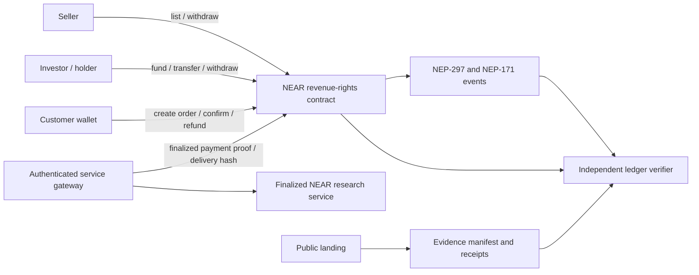

# FIRST100 product requirements

- **Version:** 2.1
- **Updated:** 15 November 2026
- **Primary track:** NFTs That Do Something
- **Product:** Verifiable revenue rights for paid AI services
- **Live landing:** https://first100-liard.vercel.app
- **Testnet contract:** `first100-v2-20261115.testnet`

> FIRST100 lets an AI service finance a bounded sequence of future, buyer-confirmed sales without selling the company, the service, its keys, or revenue outside the series. The contract routes each eligible settlement to the NFT owner at confirmation time. Previously accrued credit never moves with the NFT.

This document is both the product contract and the delivery record. It does not treat planned work as shipped work.

| Status | Meaning |
| --- | --- |
| **SHIPPED** | Implemented in the public repository |
| **VERIFIED** | Reproduced by automated tests or finalized public testnet evidence |
| **OPEN** | Required for the intended product but not complete |
| **POST-P0** | Explicitly outside the current prototype |

## 0. Truth contract

FIRST100 separates four kinds of statements:

1. Product requirements describe what the protocol must do.
2. Repository evidence describes what the current code does.
3. Finalized testnet transactions prove only the actions visible in those transactions.
4. Roadmap items are not current capabilities.

The Vercel deployment is a public landing page. It is not an interactive wallet dashboard. The NEAR testnet contract and evidence manifest are public and independently queryable. No mainnet, guaranteed-return, audited, stablecoin, or legally compliant production claim is made.

## 1. Executive summary

FIRST100 combines three operations in one auditable flow:

1. A seller lists a fixed-advance revenue series with a unit price, cap, expiry, and confirmation timeout.
2. An investor funds the series and receives a NEP-171 revenue-right NFT.
3. Customers pay for individual service calls. A gateway commits the delivered output hash, and the buyer confirms delivery. Revenue is credited to the NFT owner at that confirmation.

The live evidence series is `first100-live-001`:

| Term | Value |
| --- | ---: |
| Cap | 100 buyer-confirmed sales |
| Unit price | 0.01 NEAR |
| Advance | 0.85 NEAR |
| Current settled count | 2 |
| Current NFT owner | `investor-b.first100-v2-20261115.testnet` |

The first settlement credited Investor A. The NFT was transferred. The second settlement credited Investor B. Investor A then withdrew the first settlement without affecting Investor B or NFT ownership.

## 2. Problem, users, and non-goals

### 2.1 Problem

Early AI services need operating capital before recurring revenue is established. Equity sells broad upside, a loan depends on credit and repayment, and a decorative NFT does not prove that customer revenue exists. FIRST100 isolates one finite protocol-captured cashflow and makes its future beneficiary transferable.

### 2.2 Users

| Role | Job | Success condition |
| --- | --- | --- |
| Seller | Finance a bounded set of future service sales | Advance becomes withdrawable without transferring the business |
| Investor | Buy a finite revenue entitlement | NFT ownership and every eligible settlement are independently visible |
| Customer | Buy and confirm a real service result | Payment, output commitment, and terminal order state agree |
| Holder | Transfer the remaining entitlement | Only later settlements follow the NFT |
| Auditor | Reproduce protocol claims | Tests, RPC views, events, and evidence reconcile |
| Integrator | Connect a paid service | Payment verification and idempotent execution are reusable |

### 2.3 Non-goals

P0 does not provide debt, interest, collateral, KYC, legal receivables assignment, guaranteed returns, stablecoin settlement, cross-chain routing, an auction, fractional rights, a quality oracle, decentralized arbitration, or mainnet readiness.

## 3. Competitive position

FIRST100 is not an ownership NFT for an entire API business, a milestone invoice, a lending score, or a speculative profit-share token. Its defensible unit is a bounded sequence of future buyer-confirmed service settlements with:

- advance funding;
- onchain payment escrow;
- transferable future entitlement;
- immutable prior accrual;
- deterministic cap behavior;
- replayable settlement evidence.

This is a positioning claim, not a claim that every competitor has been independently audited.

## 4. Product principles and economic mechanism

1. **Cashflow is the asset.** The NFT is the live routing key for future eligible settlement.
2. **Ownership remains separate.** The investor does not receive service keys, IP, governance, or company equity.
3. **Payment precedes accounting.** A log cannot create revenue without a funded order.
4. **Accrual is immutable.** NFT transfer never moves existing account credit.
5. **Trust boundaries stay visible.** The contract proves payment and state transitions, not subjective output quality or off-platform revenue.

For cap `N`, unit price `p`, advance `A`, and eligible settled count `k`, gross holder revenue is `k * p`, where `0 <= k <= N`. The protocol does not guarantee that `k` reaches `N`. For the live terms, break-even before fees is 85 confirmed calls and maximum gross revenue is 1 NEAR.

“First N” means the deterministic finalization order of successful `confirm_delivery` calls, not order creation time. If the NFT moves before an order is confirmed, the new owner receives that settlement. If it moves after confirmation, the previous beneficiary keeps the accrued credit.

## 5. Scope and release strategy

| Area | P0 requirement | Delivery status |
| --- | --- | --- |
| Settlement | Native NEAR order funding and pull-payment credit | **VERIFIED** |
| Revenue right | Core transfer, transfer-call resolver, metadata, events | **SHIPPED**; resolver race covered locally |
| Financing | Fixed price, one investor, active-series lock | **VERIFIED** |
| Service | Finalized NEAR account research output | **VERIFIED** in two recorded receipts |
| Delivery proof | Request hash, response hash, buyer confirmation | **VERIFIED** |
| Refund | Buyer timeout refund and terminality | **VERIFIED** locally; live proof recorded separately |
| Ledger | Event replay and `audit_totals` reconciliation | **VERIFIED** |
| Public web | Submission landing and evidence links | **SHIPPED** |
| Wallet dashboard | Seller, investor, customer, holder, proof workflows | **OPEN**; source screens exist but public route remains disabled |
| Stablecoin and multichain | NEP-141 or cross-chain settlement | **POST-P0** |

P1 work must never weaken withdrawal rollback, refund terminality, cap enforcement, or settlement-time ownership.

## 6. User stories and acceptance

### US-01 — Register a service and list a series

Only the service operator may create a series. Identifiers, endpoint commitment, positive values, future expiry, timeout bounds, and exact storage deposits are validated. Funding terms become immutable after listing.

**Status:** **VERIFIED** by unit tests, sandbox execution, and finalized testnet service and series transactions.

### US-02 — Fund once and mint the right

The exact advance changes the series from `LISTED` to `FUNDED`, credits the seller, locks the service against overlapping active financing, and mints one NFT to the investor. A second funding attempt fails.

**Status:** **VERIFIED**. Live funding transaction: `Cvm36ephVCw6x1QPb51HiXSHkWAAgzBTvcPU3vYwte8v`.

### US-03 — Pay for and execute a real service

A customer funds an order with the exact unit price and a unique nonce. The gateway validates the buyer, finalized payment transaction, request hash, and order state before executing once. The current service reads finalized NEAR RPC account data and produces a canonical response hash.

**Status:** Contract and service outputs **VERIFIED**. Gateway payment and idempotency behavior are covered by integration tests; the public gateway process is not hosted.

### US-04 — Confirm and allocate revenue

Only the order buyer can confirm the committed response hash. Before the cap, the current NFT owner is credited atomically. After the cap, later revenue returns to the seller.

**Status:** **VERIFIED** locally and by two finalized testnet confirmations.

### US-05 — Transfer only future revenue

`nft_transfer` changes the beneficiary of later settlement without moving prior credit. `nft_transfer_call` sets a pending-transfer lock until the resolver accepts or reverts ownership.

**Status:** Direct transfer behavior **VERIFIED** on testnet. Transfer-call pending-state behavior is **VERIFIED** by contract tests.

### US-06 — Withdraw safely

Withdrawal uses checks-effects-interactions, records an in-flight liability, sends an asynchronous transfer, and either completes or restores credit exactly once.

**Status:** Success and rollback paths **VERIFIED** locally. Seller and prior-holder success paths are **VERIFIED** on testnet.

### US-07 — Refund after timeout

Only the buyer can claim after the confirmation deadline. Refunded and settled states are terminal and mutually exclusive.

**Status:** **VERIFIED** by adversarial unit tests and a finalized testnet refund.

### US-08 — Audit independently

An auditor can replay terminal events from real transaction receipts, enforce caps and unique terminal outcomes, and compare totals with finalized `audit_totals`.

**Status:** **VERIFIED** by `npm run verify:ledger`.

## 7. System architecture



The contract is the authority for money, ownership, and order state. The gateway is the authority only for offchain execution. The UI is never the source of truth. Full component boundaries and sequences are documented in [ARCHITECTURE.md](ARCHITECTURE.md).

## 8. Contract state and interface

Core entities are `Service`, `RevenueSeries`, `ApiOrder`, per-account credit, withdrawal records, NFT ownership, pending NFT transfers, used buyer nonces, open order counts, and the active series lock per service.

### Series lifecycle

`LISTED -> FUNDED -> CLOSED`, with `LISTED -> CANCELLED` before funding. Funded economic terms cannot change. Expired series cannot accept new orders and cannot close while orders remain unresolved.

### Order lifecycle

`PAID_PENDING -> DELIVERED -> SETTLED` or `PAID_PENDING|DELIVERED -> REFUNDED` after timeout. `SETTLED` and `REFUNDED` are terminal.

### Required methods

| Group | Methods |
| --- | --- |
| Service and series | `register_service`, `set_service_active`, `create_series`, `cancel_unfunded_series`, `close_expired_series` |
| Financing and orders | `fund_series`, `create_order`, `submit_delivery_hash`, `confirm_delivery`, `claim_refund` |
| Credit | `withdraw`, private `on_withdraw_complete` |
| NFT | `nft_transfer`, `nft_transfer_call`, private `nft_resolve_transfer`, `nft_token`, `nft_metadata` |
| Audit views | `get_service`, `get_series`, `get_order`, `get_credit`, `get_withdrawal`, `get_active_series`, `get_open_order_count`, `is_transfer_pending`, `audit_totals` |

All financial values use integer yoctoNEAR. Floating-point accounting is prohibited.

## 9. Gateway and delivery verification

The gateway exposes health, quote, challenge, execute, and order-status routes. Execution requires:

1. an order in the expected onchain state;
2. an access key belonging to the buyer;
3. a valid single-use challenge and wallet signature;
4. a finalized `create_order` transaction whose returned order ID matches;
5. a request payload whose canonical hash matches the contract;
6. idempotent execution storage;
7. an onchain response-hash commitment.

The P0 JSON store is atomic for one process but is not a production multi-instance database.

## 10. Product experience

The intended dashboard contains seller, investor, customer, holder, and proof views. It must show exact transaction state, distinguish pending from finalized operations, expose explorer links, and state that returns are not guaranteed.

The current public deployment deliberately exposes only the landing page and a `COMING SOON` dashboard preview. Wallet connection is disabled there. This is an **OPEN** product-surface item, not a hidden claim.

## 11. Agent role

The service agent detects a paid order, verifies access, executes a useful request, commits the response hash, and waits for customer confirmation. It cannot change financing terms, move a holder's NFT, or arbitrarily transfer customer funds. Automated investor decision-making is **POST-P0**.

## 12. Security model

The P0 security properties include unique order terminality, buyer-only confirmation and refund, exact-deposit checks, cap enforcement, active-series locking, prior-credit isolation, pending-transfer settlement blocking, checked arithmetic, withdrawal rollback, and finalized RPC verification.

The protocol cannot prevent seller bypass, Sybil demand, buyer refusal to confirm, poor service quality, token volatility, or legal risk. See [THREAT_MODEL.md](THREAT_MODEL.md) and [KNOWN_LIMITATIONS.md](KNOWN_LIMITATIONS.md).

## 13. Accounting and failure semantics

At all times:

```text
liabilities = user credits + active order escrow + in-flight withdrawals
available assets = contract balance - storage locked - operating reserve
available assets >= liabilities
```

The live audit reports zero open escrow, zero in-flight withdrawals, and `solvent: true`. Events support replay, while contract state remains authoritative.

## 14. Metrics and economics

Required metrics are funded advance, settled calls, settled revenue, credits by beneficiary, refund rate, time to confirm, expiry, theoretical maximum revenue, and remaining eligible calls. Break-even is an explanatory scenario, not a return forecast. APY must not be shown.

## 15. Test and release strategy

Current automated evidence:

- 31 Rust contract unit and adversarial tests;
- 8 gateway integration tests;
- 6 SDK and independent ledger tests;
- 5 near-workspaces sandbox flows using six role accounts;
- 1 Chromium landing-state E2E test;
- finalized public testnet evidence replay.

Release is red if funds can become unrecoverable, settlement can double-credit, the cap can be exceeded, ownership routing is wrong, tests fail, or evidence is fabricated. An interactive dashboard, hosted gateway, audit, and production database remain required before any production release.

## 16. Repository contract

```text
contracts/revenue-rights/   onchain state, NFT, settlement, accounting
gateway/                    authenticated paid-service adapter
sdk/                        RPC helpers and independent ledger replay
app/                        public landing and dormant role screens
tests/workspaces/           multi-account sandbox evidence
tests/e2e/                  browser submission-state check
evidence/                   finalized hashes and service receipts
docs/                       architecture, security, invariants, demo, PRD
scripts/                    reproducible build and deployment commands
```

Secrets, private keys, fabricated hashes, and Turkish repository content are prohibited.

## 17. Delivery gates

| Gate | Result |
| --- | --- |
| Contract state and unit tests | **VERIFIED** |
| Accounting, withdrawal, refund, and adversarial behavior | **VERIFIED** |
| Multi-account sandbox flow | **VERIFIED** |
| Public testnet contract and evidence | **VERIFIED** |
| Real finalized-RPC service outputs | **VERIFIED** |
| Public landing | **SHIPPED** |
| Hosted interactive dashboard | **OPEN** |
| Hosted authenticated gateway | **OPEN** |
| Independent security audit | **OPEN** |

## 18. Judge evidence package

- Contract: https://explorer.testnet.near.org/accounts/first100-v2-20261115.testnet
- First settlement to Investor A: https://explorer.testnet.near.org/transactions/2T7cBtrycCjcNxQzVDkJVxFEoCa9Rb2wAxvqESvqt8Ek
- NFT transfer: https://explorer.testnet.near.org/transactions/9iA3WXYeZpXdBBJhsFXTkazM1KCygg3YT4K6t6fXtCHF
- Second settlement to Investor B: https://explorer.testnet.near.org/transactions/78ZKVU5irTEUDW9BrEKfkCB74a1dbaD3QHFbtsRcPWdN
- Seller withdrawal: https://explorer.testnet.near.org/transactions/FdfAYhTiqJKPJkph4PkW8zrKpHkeL6FbV5fBbH5tdvxt
- Prior-holder withdrawal: https://explorer.testnet.near.org/transactions/4X9WegLzv5dFLTSPvgPQGaGgbWYzEchcwoYY5EEoLtWN
- Timeout refund: https://explorer.testnet.near.org/transactions/6grwuYPbzXh66FVXEV9uQcuBqMkGw7WKkLp51yHogYvD
- Refund withdrawal: https://explorer.testnet.near.org/transactions/2bUphNwqdz6VpHq1kn8XfnxHcGcfUiC9tQSi1sdjjnZt
- Machine-readable manifest: [`evidence/testnet-transactions.json`](../evidence/testnet-transactions.json)
- Service receipts: [`evidence/service-receipts.json`](../evidence/service-receipts.json)

## 19. Demo sequence

1. Explain that the product sells a finite cashflow right, not the company.
2. Show the funded 100-sale series and Investor A's NFT ownership at mint.
3. Open Customer C's payment, delivery commitment, and confirmation.
4. Show that Investor A received the first credit.
5. Open the NFT transfer to Investor B.
6. Open Customer D's payment, delivery commitment, and confirmation.
7. Show that Investor B received the second credit while Investor A withdrew the first.
8. Run `npm run verify:ledger` and show the reconciled totals.

The demo must not call the landing an interactive app or call testnet funds real investment returns.

## 20. Submission checklist

- [x] Public repository and lockfiles
- [x] Reproducible build and automated tests
- [x] Public landing URL
- [x] Public testnet contract
- [x] Finalized funding, service, transfer, settlement, refund, and withdrawal evidence
- [x] Threat model, invariants, limitations, architecture, and demo script
- [ ] Public demo video or screenshot post on X
- [ ] Exact submission payload confirmed by the human
- [ ] Submission receipt confirmed

The official development deadline was 14 November 2026 at 23:59 UTC. If a submission already exists, corrections must use the official request-changes flow rather than a duplicate submission.

## 21. Architecture decisions

| Decision | Choice | Reason |
| --- | --- | --- |
| Settlement asset | Native NEAR first | Avoids FT storage and callback scope in P0 |
| Financing | Fixed advance | Prioritizes entitlement correctness over price discovery |
| Asset boundary | First N settlements only | Separates business ownership from revenue entitlement |
| Fulfillment | Buyer confirmation | Makes the P0 trust boundary explicit |
| Ownership time | Confirmation time | Deterministic future-only transfer behavior |
| Payment delivery | Pull credit | Supports callback-safe withdrawal and refunds |
| Public UI | Landing first | Avoids exposing an unverified wallet flow |

## 22. Known limitations

1. The seller can route equivalent business outside FIRST100.
2. Customer identity and economic independence are not Sybil-proof.
3. Buyer confirmation does not prove objective service quality.
4. A buyer can receive service and refuse confirmation until refund becomes available.
5. Native NEAR creates token-price exposure.
6. One transaction per call creates wallet and gas friction.
7. The JSON gateway store is single-process only.
8. The system has not received an independent security or legal audit.
9. The public dashboard and hosted gateway are not released.
10. Testnet evidence is not mainnet production evidence.

## 23. Post-P0 roadmap

### First 30 days

Security audit preparation, production database design, hosted gateway, interactive dashboard, NEP-141 settlement research, SDK packaging, stateful sandbox testing, and legal classification review.

### First 90 days

Marketplace compatibility, optional enumeration and approvals, secondary pricing, tranches, metered sessions, x402 interoperability, external attestation research, and mainnet-readiness review.

## 24. Judge-ready language

**One line:** FIRST100 turns an AI service's next 100 buyer-confirmed, onchain-paid requests into a transferable revenue right on NEAR, while the operator keeps the business and all later revenue.

**Why NEAR:** NEAR is the enforceable settlement layer. It makes the entitlement transferable, resolves the beneficiary at confirmation time, preserves prior accrual, and leaves a public event trail that can be replayed independently.

**Biggest risk:** The contract can enforce only revenue routed through it and cannot objectively prove offchain output quality. Those are explicit merchant and delivery risks, not hidden assumptions.

## 25. Sources

- Official event and submission rules: https://nearhackathon.com/HACKATHON.md
- NEP-171 NFT standard: https://github.com/near/NEPs/blob/master/neps/nep-0171.md
- NEP-297 event standard: https://github.com/near/NEPs/blob/master/neps/nep-0297.md
- NEAR cross-contract calls: https://docs.near.org/smart-contracts/anatomy/crosscontract
- Repository architecture: [ARCHITECTURE.md](ARCHITECTURE.md)
- Protocol invariants: [INVARIANTS.md](INVARIANTS.md)

## 26. Engineering handoff

The protocol core and public evidence are complete for the current P0 claim. Remaining work must proceed in this order:

1. Keep the evidence verifier green after every contract or manifest change.
2. Deploy the authenticated gateway without exposing a full-access private key.
3. Re-enable role screens only after wallet flows are tested against the deployed contract.
4. Add browser E2E coverage for seller, investor, customer, holder, and proof workflows.
5. Replace the landing's `COMING SOON` state only when those tests pass.
6. Obtain independent security and legal review before mainnet or real investment use.

No future implementation may weaken cap enforcement, active-series locking, buyer-only terminal actions, settlement-time ownership, prior-credit isolation, or withdrawal rollback.
