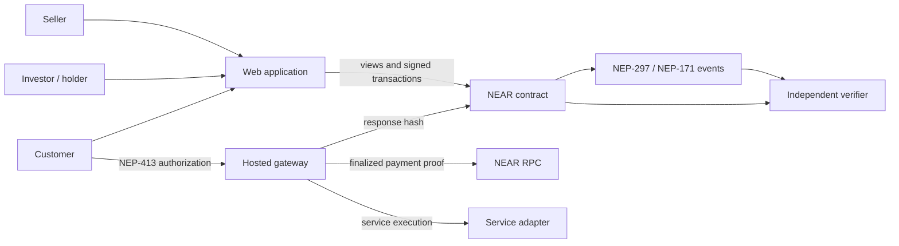

# FIRST100 product requirements

- **Version:** 3.0
- **Updated:** 15 November 2026
- **Product:** Verifiable revenue financing for paid AI services
- **Application:** https://first100-liard.vercel.app/app
- **Testnet contract:** `first100-v2-20261115.testnet`

> FIRST100 lets an AI service finance a bounded sequence of future, buyer-confirmed sales without selling the company, the service, its keys, or revenue outside that sequence. The contract routes each eligible settlement to the NFT owner at confirmation time. Previously accrued credit never moves with the NFT.

This document is the product contract and delivery record. Requirements are cumulative: P1 includes the P0 foundation, and P2 includes both earlier phases. A planned capability is never presented as shipped.

| Status | Meaning |
| --- | --- |
| **VERIFIED** | Reproduced by automated tests or finalized public chain evidence |
| **SHIPPED** | Implemented and available in the repository or public application |
| **IN PROGRESS** | Actively being built; not a current product claim |
| **PLANNED** | Accepted scope with defined acceptance criteria |
| **EXTERNAL GATE** | Requires qualified independent review or third-party infrastructure |

## 0. Truth contract

1. Product requirements state intended behavior.
2. Repository evidence states what the current code implements.
3. Finalized transactions prove only the actions visible in those transactions.
4. Testnet funds are not evidence of investment performance.
5. Security and legal reviews must be attributed to the actual reviewer and report.

The application, hosted gateway, testnet contract, and evidence manifest are public. No guaranteed-return, audited, legally compliant, or mainnet-production claim is made.

## 1. Product outcome

FIRST100 combines three operations in one auditable system:

1. A seller lists a fixed-advance revenue series with a unit price, cap, expiry, and confirmation timeout.
2. An investor funds the series and receives a transferable NEP-171 revenue-right NFT.
3. Customers pay for service calls. The gateway commits the output hash and the buyer confirms delivery. Revenue is credited to the NFT owner at that confirmation.

The live evidence series is `first100-live-001`:

| Term | Value |
| --- | ---: |
| Cap | 100 buyer-confirmed sales |
| Unit price | 0.01 NEAR |
| Advance | 0.85 NEAR |
| Confirmed entitlement | 2 sales |
| Current holder | `investor-b.first100-v2-20261115.testnet` |

## 2. Users

| Role | Job | Success condition |
| --- | --- | --- |
| Seller | Finance a bounded set of future sales | Advance becomes withdrawable without transferring the business |
| Investor | Acquire a finite revenue entitlement | Terms, ownership, risk, and settlement history are independently visible |
| Customer | Buy and confirm a real service result | Payment, output commitment, and terminal order state agree |
| Holder | Transfer the remaining entitlement | Only later settlements follow the NFT |
| Auditor | Reproduce protocol claims | Tests, views, events, receipts, and liabilities reconcile |
| Integrator | Connect a paid service | Payment verification and execution controls are reusable |

## 3. Product boundary

The NFT includes only the remaining eligible settlements in one series. It does not include company equity, service ownership, source code, credentials, governance, historical credit, guaranteed yield, or revenue collected outside the protocol.

FIRST100 is not debt, a credit score, or a claim on every future sale. Legal classification depends on jurisdiction and deployment structure and remains an external gate.

## 4. Economic mechanism

For cap `N`, unit price `p`, advance `A`, and eligible settled count `k`:

```text
holder gross revenue = k * p
0 <= k <= N
remaining entitlement = N - k
```

“First N” means the finalization order of successful `confirm_delivery` calls. Ownership is read at confirmation time. Transfer before confirmation routes that settlement to the new holder; transfer after confirmation leaves the earlier credit with the prior holder.

## 5. Cumulative delivery scope

### P0 — Protocol foundation

| Capability | Acceptance | Status |
| --- | --- | --- |
| Native NEAR financing | Exact advance, one-time funding, seller credit | **VERIFIED** |
| Revenue-right NFT | Mint, direct transfer, transfer-call resolver, metadata, events | **VERIFIED** |
| Paid service order | Exact price, request commitment, unique buyer nonce | **VERIFIED** |
| Delivery settlement | Gateway commitment, buyer confirmation, settlement-time holder | **VERIFIED** |
| Refund and withdrawal | Mutually exclusive terminal state, callback-safe pull payment | **VERIFIED** |
| Independent accounting | Event replay, cap checks, `audit_totals` reconciliation | **VERIFIED** |
| Public evidence | Finalized funding, service, transfer, settlement, refund, withdrawal | **VERIFIED** |

### P1 — Complete product

| Capability | Acceptance | Status |
| --- | --- | --- |
| Interactive application | Seller, investor, customer, holder, and proof workflows | **SHIPPED** |
| Hosted authenticated gateway | Method-restricted key, finalized payment proof, wallet challenge | **SHIPPED** |
| Portfolio discovery | Paginated series and holder enumeration with filters | **SHIPPED** |
| NEP-171 approvals | Approval, revoke, revoke-all, and enumeration compatibility | **SHIPPED** |
| Multi-service adapters | Typed adapter registry, schemas, metering, SDK examples | **SHIPPED** |
| Stable settlement | Whitelisted NEP-141 assets with storage and callback safety | **PLANNED** |
| Risk view | Scenario analysis without APY or guaranteed-return language | **SHIPPED** |
| Durable execution | Onchain worker lease, unique order execution, expiry-based recovery | **SHIPPED** |
| Independent attestation | Signed service evidence from an operator-independent verifier | **PLANNED** |
| Wallet-gated investor policy | Deterministic limits for advance, entitlement, break-even, and services; explicit wallet approval | **SHIPPED** |

### P2 — Protocol expansion

| Capability | Acceptance | Status |
| --- | --- | --- |
| Marketplace | Listings, offers, cancellation, settlement, royalty-free right transfer | **PLANNED** |
| Financing tranches | Immutable tranche terms and aggregate cap safety | **PLANNED** |
| Session metering | Prepaid budgets, signed usage receipts, close and refund | **PLANNED** |
| x402 / MPP adapters | Standards-based payment negotiation mapped to one order authority | **PLANNED** |
| Cross-chain intents | Explicit adapters, replay domains, finality policy, no synthetic evidence | **PLANNED** |
| Quality and dispute layer | Pluggable oracle or arbitration with bounded authority | **PLANNED** |
| Risk and insurance hooks | Opt-in coverage adapter without changing base liabilities | **PLANNED** |
| Mobile SDK | Typed signing, quoting, payment, confirmation, refund, proof retrieval | **PLANNED** |
| Privacy proofs | Selective disclosure for service evidence where technically justified | **PLANNED** |
| Mainnet readiness | External security review, legal review, operations runbook | **EXTERNAL GATE** |

P1 and P2 may extend the system, but they may never weaken the P0 accounting and ownership invariants.

## 6. Core user stories

### US-01 — Register and list

Only the service operator can create a series. Identifiers, endpoint commitment, positive values, future expiry, timeout bounds, and storage deposits are validated. Funding terms become immutable after listing.

### US-02 — Fund and mint

The exact advance changes a series from `LISTED` to `FUNDED`, credits the seller, locks the service against overlapping active financing, and mints one NFT to the investor.

### US-03 — Pay and execute

The buyer funds an order with the exact price and a unique nonce. Before execution, the gateway validates buyer authorization, finalized payment, returned order ID, request commitment, and order state.

### US-04 — Confirm and allocate

Only the order buyer can confirm the committed response hash. Before the cap, the current NFT owner receives credit. After the cap, later service revenue returns to the seller.

### US-05 — Transfer only the future

NFT transfer changes later routing without moving prior credit. Settlement is blocked while an asynchronous transfer resolver is pending.

### US-06 — Withdraw safely

Withdrawal moves credit into an in-flight liability before the transfer. The callback completes the withdrawal or restores the credit exactly once.

### US-07 — Refund after timeout

Only the buyer can claim after the deadline. `SETTLED` and `REFUNDED` are mutually exclusive terminal outcomes.

### US-08 — Verify independently

An auditor can replay terminal events from finalized receipts, enforce caps and unique outcomes, and compare reconstructed totals with contract state.

## 7. System architecture



The contract is authoritative for money, ownership, and terminal order state. The gateway is authoritative only for offchain execution. The UI and gateway cache are never accounting authorities. See [ARCHITECTURE.md](ARCHITECTURE.md).

## 8. Onchain state machines

```text
Series: LISTED -> FUNDED -> CLOSED
        LISTED -> CANCELLED

Order:  PAID_PENDING -> DELIVERED -> SETTLED
        PAID_PENDING | DELIVERED -> REFUNDED after deadline

Withdrawal: IN_FLIGHT -> COMPLETED | RESTORED
```

All monetary values are integer base units. Floating-point accounting is prohibited.

## 9. Gateway security

Execution requires:

1. a finalized `PAID_PENDING` order;
2. an active access key belonging to the buyer;
3. a 32-byte, short-lived, order- and buyer-bound challenge;
4. a valid NEP-413 signature;
5. a finalized `create_order` transaction with the expected signer, receiver, method, and returned order ID;
6. a request whose canonical hash matches the onchain commitment; and
7. a method-restricted gateway key that can call only execution lease and leased delivery methods.

Local mode persists challenges and executions in an atomic JSON store. Hosted mode uses HMAC-signed stateless challenges and time-bounded onchain execution leases. A worker must acquire the unique order lease before adapter execution; a matching, unexpired lease is required to commit delivery. Failed work releases immediately and crashed work becomes recoverable after expiry.

## 10. Product experience

The public application provides five role views:

- **Seller:** register a service and list bounded financing terms.
- **Investor:** inspect finalized terms, calculate a simple break-even call count, and fund the exact advance.
- **Customer:** quote, pay, authorize execution, inspect output, confirm delivery, or claim a timed-out refund.
- **Holder:** inspect ownership and credit, transfer future rights, and withdraw.
- **Proof:** open finalized transactions and contract state without trusting the UI.

Every action must state whether it is pending or finalized, and every financial result must resolve to chain state or an explorer link.

## 11. Accounting invariants

```text
total liabilities
  = user credits
  + active order escrow
  + in-flight withdrawals

available assets
  = contract balance
  - storage locked
  - operating reserve

available assets >= total liabilities
```

Additional invariants are defined in [INVARIANTS.md](INVARIANTS.md).

## 12. Security boundaries

The protocol enforces unique terminal outcomes, buyer-only confirmation and refund, exact deposits, cap safety, active-series locking, prior-credit isolation, transfer-resolver safety, checked arithmetic, withdrawal rollback, and finalized payment verification.

It cannot prevent off-platform seller bypass, Sybil demand, buyer refusal to confirm, poor output quality, asset-price volatility, compromised frontends, or legal risk. See [THREAT_MODEL.md](THREAT_MODEL.md) and [KNOWN_LIMITATIONS.md](KNOWN_LIMITATIONS.md).

## 13. Metrics

The product may show funded advance, confirmed calls, settled revenue, remaining eligible calls, beneficiary credits, refund rate, confirmation latency, expiration, and theoretical maximum revenue. Break-even is a scenario, not a forecast. The UI must not show APY or imply guaranteed returns.

## 14. Test and release gates

Current automated evidence:

- 35 Rust contract unit and adversarial tests;
- 15 gateway tests;
- 10 SDK, policy, and ledger replay tests;
- 5 near-workspaces sandbox flows using six roles;
- Chromium coverage for the landing and application route;
- finalized public testnet evidence replay.

A release is blocked if funds can become unrecoverable, settlement can double-credit, the cap can be exceeded, ownership routing is wrong, secrets are committed, tests fail, or evidence is fabricated.

## 15. Repository contract

```text
contracts/revenue-rights/   onchain state, NFT, settlement, accounting
gateway/                    authenticated service and execution adapter
api/                        hosted serverless gateway entrypoint
sdk/                        RPC helpers and independent ledger replay
app/                        landing and role-based product workflows
tests/workspaces/           multi-account sandbox execution
tests/e2e/                  browser product checks
evidence/                   finalized transaction and service receipts
docs/                       requirements, architecture, security, invariants
scripts/                    reproducible build, deployment, and configuration
```

Secrets, private keys, fabricated hashes, and non-English repository copy are prohibited.

## 16. Evidence package

- Contract: https://explorer.testnet.near.org/accounts/first100-v2-20261115.testnet
- Portfolio upgrade: https://explorer.testnet.near.org/transactions/59jfjSMMExNGKB4QP6pj6ohpL3QCg2RuoMAqbTZstL2p
- Execution-lease upgrade: https://explorer.testnet.near.org/transactions/9u8GDokLqWpsoXCUNL3s4MW2QXZphXw7TbLR7xBTfsJn
- Restricted gateway key: https://explorer.testnet.near.org/transactions/FeEB1dbQ1vK4Ez3LsbRs9g1CgqXELx21dEkM8QwR1cSf
- Legacy gateway key revocation: https://explorer.testnet.near.org/transactions/3EDd9mh2pAM7V64yV1dGdGMbaMYSVJs481nBs8qCiMXM
- Funding: https://explorer.testnet.near.org/transactions/Cvm36ephVCw6x1QPb51HiXSHkWAAgzBTvcPU3vYwte8v
- First settlement: https://explorer.testnet.near.org/transactions/2T7cBtrycCjcNxQzVDkJVxFEoCa9Rb2wAxvqESvqt8Ek
- NFT transfer: https://explorer.testnet.near.org/transactions/9iA3WXYeZpXdBBJhsFXTkazM1KCygg3YT4K6t6fXtCHF
- Second settlement: https://explorer.testnet.near.org/transactions/78ZKVU5irTEUDW9BrEKfkCB74a1dbaD3QHFbtsRcPWdN
- Timeout refund: https://explorer.testnet.near.org/transactions/6grwuYPbzXh66FVXEV9uQcuBqMkGw7WKkLp51yHogYvD
- Machine-readable manifest: [`evidence/testnet-transactions.json`](../evidence/testnet-transactions.json)
- Service receipts: [`evidence/service-receipts.json`](../evidence/service-receipts.json)

## 17. Architecture decisions

| Decision | Choice | Reason |
| --- | --- | --- |
| Base settlement | Native NEAR | Minimizes the first accounting and callback surface |
| Financing | Fixed advance | Makes funding and entitlement deterministic |
| Asset boundary | First N confirmed settlements | Separates business ownership from revenue rights |
| Acceptance | Buyer confirmation | Keeps subjective output quality outside base accounting |
| Ownership time | Confirmation time | Makes future-only transfer behavior deterministic |
| Payout | Pull credit | Enables callback-safe withdrawal and refund accounting |
| Gateway key | Function-call access only | Limits compromise to one delivery-commitment method |
| Expansion | Adapter-based | Keeps stablecoin, cross-chain, and quality systems outside the base invariant set |

## 18. Delivery order

All phases are committed scope and must be completed in dependency order:

1. Preserve evidence replay, accounting invariants, and adversarial coverage.
2. Complete portfolio discovery, NFT approvals/enumeration, typed service adapters, and wallet-gated policy evaluation.
3. Add durable execution storage and recovery semantics.
4. Add whitelisted NEP-141 settlement with full callback and storage tests.
5. Add marketplace, tranches, metered sessions, and payment-protocol adapters.
6. Add explicit cross-chain intent adapters and bounded dispute or quality modules.
7. Complete external security and legal review before mainnet or real-value use.

No later implementation may weaken cap enforcement, active-series locking, buyer-only terminal actions, settlement-time ownership, prior-credit isolation, or withdrawal rollback.

## 19. External gates

The following cannot be completed by repository code alone:

- independent smart-contract and application security audit;
- jurisdiction-specific legal and tax review;
- production incident response ownership;
- third-party stablecoin, bridge, oracle, and insurance due diligence.

These gates must remain open until actual reports, owners, and operating procedures exist.

## 20. Sources

- NEP-171 NFT standard: https://github.com/near/NEPs/blob/master/neps/nep-0171.md
- NEP-297 event standard: https://github.com/near/NEPs/blob/master/neps/nep-0297.md
- NEAR cross-contract calls: https://docs.near.org/smart-contracts/anatomy/crosscontract
- Repository architecture: [ARCHITECTURE.md](ARCHITECTURE.md)
- Protocol invariants: [INVARIANTS.md](INVARIANTS.md)
